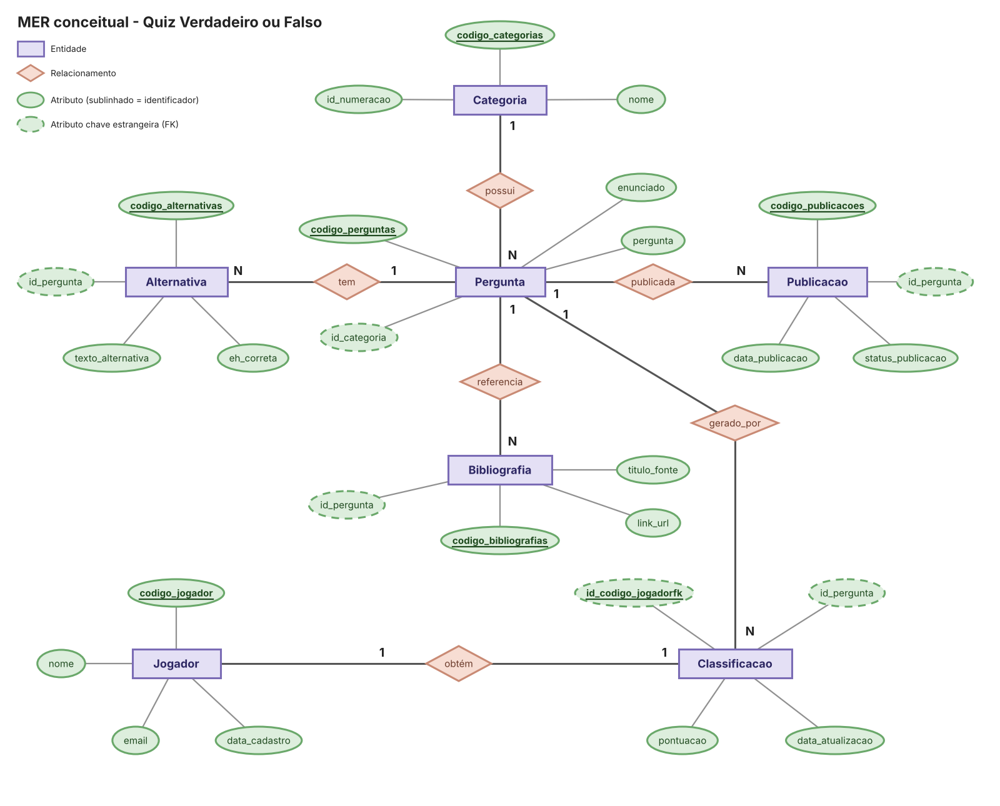

# Passo 4 — Modelo conceitual

É um DER na notação de Chen, no brModelo ou no Visual Paradigm Online. Entidades, atributos, relacionamentos e cardinalidades. Ainda não aparecem chaves estrangeiras nem tipos de colunas do modelo físico: isso pertence ao modelo lógico (passo 5).

## Entidades

| Entidade | Atributos | Identificador |
| --- | --- | --- |
| Categoria | codigo_categorias, id_numeracao, nome | codigo_categorias |
| Pergunta | codigo_perguntas, id_categoria, pergunta, enunciado | codigo_perguntas |
| Alternativa | codigo_alternativas, id_pergunta, texto_alternativa, eh_correta | codigo_alternativas |
| Publicacao | codigo_publicacoes, id_pergunta, data_publicacao, status_publicacao | codigo_publicacoes |
| Bibliografia | codigo_bibliografias, id_pergunta, titulo_fonte, link_url | codigo_bibliografias |
| Jogador | codigo_jogador, nome, email, data_cadastro | codigo_jogador |
| Classificacao | id_codigo_jogadorfk, id_pergunta, pontuacao, data_atualizacao | id_codigo_jogadorfk |

## Relacionamentos

Uma frase por linha, ligada a um requisito. Cardinalidade dos dois lados, mínimo e máximo.

| Relacionamento | Cardinalidade | Justificativa | Requisito |
| --- | --- | --- | --- |
| Categoria possui Pergunta | Categoria (1,1) — (0,N) Pergunta | Uma categoria pode ter várias perguntas associadas (ou nenhuma), e cada pergunta pertence a exatamente uma categoria (via `id_numeracao` / `id_categoria`). | RD01 |
| Pergunta tem Alternativa | Pergunta (1,1) — (1,N) Alternativa | Toda pergunta possui alternativas associadas (ex: TRUE e FALSE), e cada alternativa pertence a uma única pergunta. | RD02 |
| Pergunta publicada em Publicacao | Pergunta (1,1) — (0,N) Publicacao | Uma pergunta pode ter um ou mais registros de publicação de histórico, e cada registro de publicação diz respeito a apenas uma pergunta. | RD03 |
| Pergunta referencia Bibliografia | Pergunta (1,1) — (0,N) Bibliografia | Uma pergunta pode referenciar zero ou mais fontes bibliográficas (links/citações), e cada registro de bibliografia é associado a apenas uma pergunta. | RD04 |
| Pergunta gerado_por Classificacao | Pergunta (0,1) — (0,N) Classificacao | Uma pontuação no ranking pode estar opcionalmente vinculada à última pergunta respondida (`id_pergunta` aceita NULL com `ON DELETE SET NULL`), enquanto uma pergunta pode ser vinculada a várias pontuações. | RD05 |
| Jogador obtém Classificacao | Jogador (1,1) — (0,1) Classificacao | Cada jogador possui no máximo uma entrada única no ranking geral (relacionamento 1:1 via chave compartilhada `id_codigo_jogadorfk`), e toda pontuação registrada pertence obrigatoriamente a um jogador. | RD06 |

## Imagem

